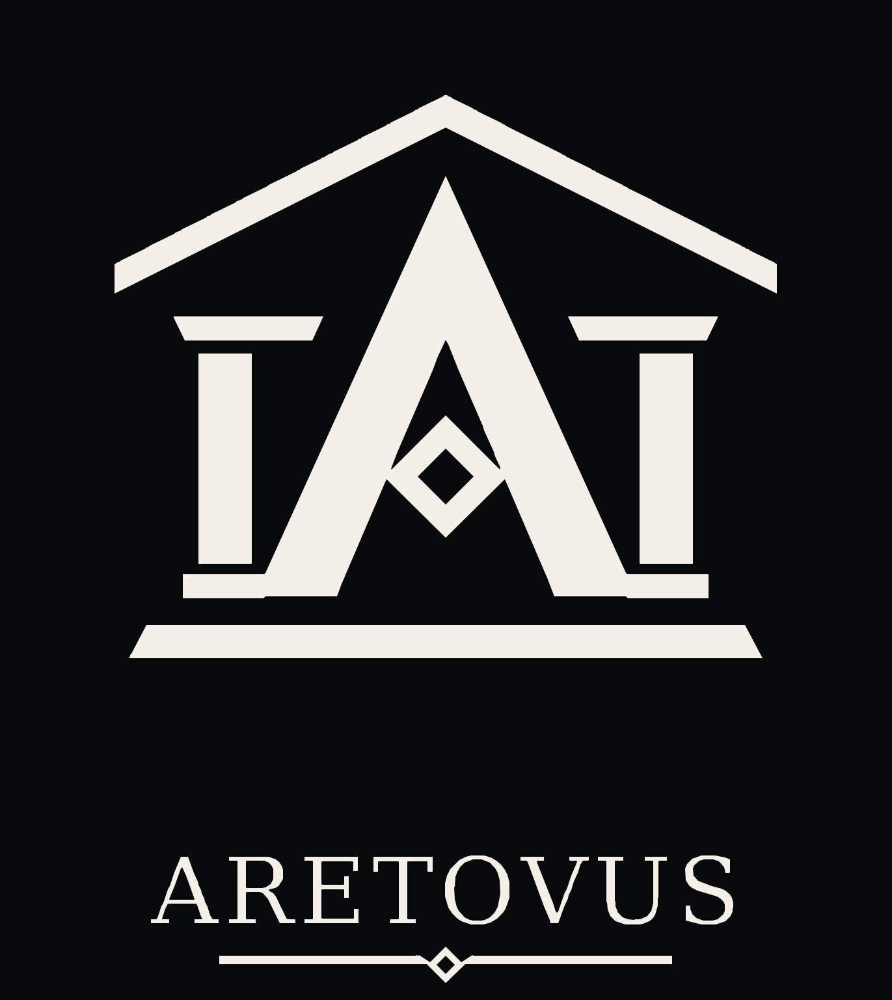

# ARETOVUS — laboratoire blockchain open source

**[Commencer ici](docs/README.md) · [Comprendre](docs/01-demarrer/COMPRENDRE_ARETOVUS.md) · [Installer](docs/guide-fr/03-installation.md) · [Contribuer](docs/02-participer/CONTRIBUER_AVEC_IA.md) · [Sécurité](SECURITY.md) · [Roadmap](https://github.com/antoineforterax-cmd/ARETOVUS/issues/178)**



**Rust · Blockchain expérimentale · Développement humain–IA · Contributions ouvertes**

**Vous découvrez ARETOVUS ?** Commencez par **[le guide pour débuter](docs/01-demarrer/COMPRENDRE_ARETOVUS.md)**, puis consultez **[l'état réel du projet](docs/01-demarrer/ETAT_ACTUEL.md)** et **[l'index de la documentation](docs/README.md)**. Aucune connaissance préalable en Rust n'est nécessaire pour comprendre le fonctionnement.

ARETOVUS explore comment construire, comprendre, vérifier et améliorer collectivement une blockchain indépendante. Le projet a été **largement développé avec l'aide de l'IA**, sous direction humaine ; son ambition immédiate est un **laboratoire reproductible**, ouvert aux débutants comme aux spécialistes. Un futur réseau public avec minage et fonds réels reste une **perspective conditionnelle**, pas un lancement annoncé.

> **IMPORTANT — TESTNET UNIQUEMENT.** ARETOVUS **n'est pas prêt pour le mainnet ou des fonds réels**. Aucun audit humain extérieur indépendant approfondi n'est confirmé. Ne pas utiliser le logiciel pour stocker ou transférer des actifs de valeur ; ne pas exposer les nœuds de test à Internet sans étude de sécurité.

## Commencer ici

| Votre question | Guide conseillé |
| --- | --- |
| **Qu'est-ce qu'ARETOVUS et comment fonctionne une blockchain ?** | [Explication complète pour débutants](docs/01-demarrer/COMPRENDRE_ARETOVUS.md) |
| **Où en est réellement le projet ?** | [État actuel : livré, prototype, manquant](docs/01-demarrer/ETAT_ACTUEL.md) |
| **Comment tester un nœud, un wallet et un mineur ?** | [Installation et testnet local](docs/guide-fr/README.md) |
| **Je veux contribuer, même sans savoir coder** | [Guide de contribution avec ou sans IA](docs/02-participer/CONTRIBUER_AVEC_IA.md) |
| **Je veux comprendre l'architecture Rust** | [Architecture des composants](ARCHITECTURE.md) |
| **Quelle licence ? Puis-je créer un fork ?** | [Droits, licences MIT / Apache-2.0](docs/02-participer/LICENCES_ET_DROITS.md) |
| **Je vois des anciennes décisions contradictoires** | [Table des décisions clarifiées](docs/05-pilotage/DECISIONS_CLARIFIEES.md) |
| **Comment trouver un ancien rapport ou une preuve ?** | [Archives et rapports](docs/90-archives/ARCHIVES_ET_RAPPORTS.md) |

**[Ouvrir le sommaire de toute la documentation](docs/README.md)**

## Le projet en une minute

Le logiciel expérimental comprend :

- **Cœur et consensus Rust :** comptes, nonces, transactions signées ML-DSA-65 (testnet), blocs, preuve de travail SHA-256 et choix de chaîne.
- **Réseau et stockage :** nœuds TCP/P2P avec pairs configurés, synchronisation, index et reprises.
- **Wallet en ligne de commande :** clés et sauvegardes chiffrées, paiements et preuves SPV **de test**.
- **Desktop en développement :** prototype React/Tauri de consultation en lecture seule, pas un portefeuille graphique commercial abouti.
- **Travail de vérification :** tests Rust, CI GitHub, simulations et scénarios adversariaux. **Ces contrôles ne sont pas des garanties de sécurité**.

Les paramètres du testnet et leurs limites sont décrits dans [l'état actuel](docs/01-demarrer/ETAT_ACTUEL.md), le [consensus](docs/CONSENSUS.md), le [protocole](docs/PROTOCOL.md) et le [modèle d'émission](docs/EMISSION_MODEL.md). L'anonymat fort, la gouvernance de trésorerie, la récupération sociale et une infrastructure publique durable restent à rechercher, concevoir ou démontrer : **ne pas les présenter comme acquis**.

## Essayer le projet (sans fonds réels)

Le [guide français](docs/guide-fr/README.md) détaille une **release expérimentale datée du 27 octobre 2026**, pas automatiquement le `main` du jour. Respectez sa version et ses répertoires propres ; ne mélangez pas les données des anciens réseaux et du réseau ARETOVUS natif. Pour lancer le dernier code depuis les sources, suivez le [guide testnet](docs/TESTNET_GUIDE.md) et relevez le SHA.

Commandes de vérification prévues sur un poste Rust/Python compatible :

```sh
git clone https://github.com/antoineforterax-cmd/ARETOVUS.git
cd ARETOVUS
cargo fmt --all -- --check
cargo clippy --workspace --all-targets -- -D warnings
cargo build --workspace --locked
cargo test --workspace --locked
python3 scripts/testnet_smoke.py
```

Ce sont des **commandes**, pas une preuve qu'elles ont été exécutées sur votre machine. Un binaire signé, un nœud public ou un réseau à valeur financière **ne sont pas promis**.

## Participer et examiner

Les suggestions, corrections de documentation, tests et pull requests ciblées sont bienvenues. Avant de modifier le consensus, les signatures, les formats, l'émission ou les fonds, lisez [CONTRIBUTING.md](CONTRIBUTING.md), [AGENTS.md](AGENTS.md), la [politique de développement](docs/planning/IMPLEMENTATION_POLICY.md) et [SECURITY.md](SECURITY.md). Pour les constats de sécurité, privilégiez le signalement privé.

La [feuille de route V2 #178](https://github.com/antoineforterax-cmd/ARETOVUS/issues/178) décrit les objectifs de développement ; [#142](https://github.com/antoineforterax-cmd/ARETOVUS/issues/142) conserve les preuves des étapes antérieures. Consulter [GitHub Actions](https://github.com/antoineforterax-cmd/ARETOVUS/actions) pour des résultats **rattachés à un commit précis**.

## Licence, provenance et histoire

Le dépôt annonce **MIT OR Apache-2.0**, sous réserve des droits applicables aux contributions : [textes](LICENSE), [explications](docs/02-participer/LICENCES_ET_DROITS.md), [provenance du code assisté par IA](PROVENANCE.md). Les licences permissives autorisent les forks ; nous souhaitons surtout encourager les contributions vers le dépôt commun.

Les anciens documents et résultats ne sont pas effacés : [catalogue des archives](docs/90-archives/ARCHIVES_ET_RAPPORTS.md). Le projet ne prétend pas avoir déjà prouvé la sécurité d'une cryptomonnaie utilisable avec de l'argent réel.
