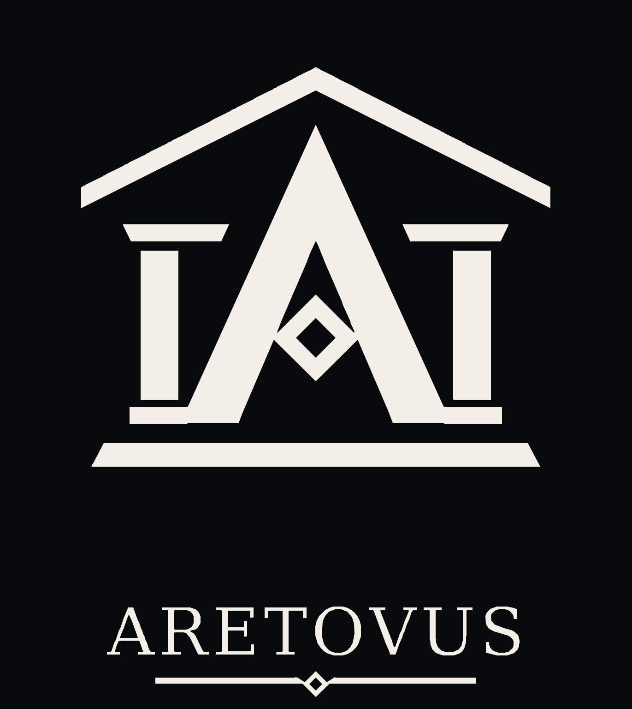

# ARETOVUS, de A à Z

  

> **Guide d'une release datée :** cette série de pages est centrée sur la release du 27 octobre 2026. Pour l'état courant et le point d'entrée unique, consultez la [carte de documentation](../README.md), puis vérifiez la version, les fichiers et le SHA avant d'exécuter une commande.

Ce guide explique le projet et permet de faire un premier essai sans compiler le code. Sa version de référence est **`testnet-v0.0.1-experimental.1`**, issue du commit **`421d443370e83a9ffa0c128da9f09d6f99b0ef8f`**, publiée le 27 octobre 2026. Le développement peut avancer après cette version : les paramètres d’un essai doivent rester rattachés au binaire utilisé.

ARETOVUS est une blockchain expérimentale. Ses unités de test servent à éprouver le logiciel; elles ne doivent pas être traitées comme des fonds réels. Le porteur a déjà relu et testé des passages du code ; le projet n’a pas encore reçu de revue E1 par une personne extérieure.

## Parcours de lecture

Ce parcours décrit les binaires de la **release expérimentale du 27 octobre 2026**. Pour la description actuelle du logiciel et des prototypes desktop, consulter [l'état du projet](../01-demarrer/ETAT_ACTUEL.md) et le [guide de fonctionnement](../01-demarrer/COMPRENDRE_ARETOVUS.md). Les anciennes pages 7 et 8 ont été retirées du parcours car remplacées par ces guides.

| Pour… | Lire… |
| --- | --- |
| Comprendre le but, les mots et les composants | [1. Comprendre ARETOVUS](01-comprendre.md) |
| Retrouver les règles monétaires exécutées | [2. Économie](02-economie.md) |
| Télécharger et vérifier les programmes | [3. Installation](03-installation.md) |
| Lancer des nœuds et miner sur un PC | [4. Premier réseau local](04-reseau-et-minage.md) |
| Envoyer un paiement et sauvegarder les clés | [5. Portefeuille et paiements](05-portefeuille.md) |
| Vérifier, sauvegarder, restaurer et dépanner | [6. Exploitation](06-exploitation.md) |
| Comprendre l'état actuel et ses limites | [État actuel (9 novembre 2026)](../01-demarrer/ETAT_ACTUEL.md) |
| Contribuer même sans coder | [Contribuer avec ou sans IA](../02-participer/CONTRIBUER_AVEC_IA.md) |
| Comprendre les licences et les forks | [Licences et droits](../02-participer/LICENCES_ET_DROITS.md) |

Les exemples principaux utilisent PowerShell sous Windows. Ils fonctionnent avec le contenu d’une archive extraite : `bin/aretovus-node.exe` et `bin/aretovus-wallet.exe`. Pour Linux et macOS, utiliser les mêmes arguments, des chemins avec `/` et les binaires sans `.exe`.

Le logiciel peut tourner entièrement sur un PC : des processus distincts possèdent chacun leur dossier et leur port. Deux fenêtres ne suffisent pas, à elles seules, à créer deux nœuds indépendants; il faut aussi deux dossiers de données. Un essai local ne démontre pas le comportement entre machines ou sur Internet.

## Sources et état du guide

Rédaction vérifiée le 28 octobre 2026. Les commandes ont été rapprochées des interfaces du [nœud](../../crates/aretovus-node/src/main.rs) et du [wallet](../../crates/aretovus-wallet/src/main.rs). Les références techniques sont la [spécification](../PROTOCOL.md), les [décisions testnet](../TESTNET_DECISIONS.md) et le [rapport d’essais](../TESTNET_VALIDATION_REPORT.md). Les pages de ce guide résument ces sources; elles ne remplacent pas le code de consensus.

L'architecture, les objectifs et les priorités sont définis par le porteur d'ARETOVUS. Des outils d'IA l'assistent pour accélérer le développement, les tests et les revues techniques. Pour le détail des contributions et des vérifications, consulter [PROVENANCE.md](../../PROVENANCE.md). Les règles de contribution figurent dans [CONTRIBUTING.md](../../CONTRIBUTING.md) et le signalement des failles dans [SECURITY.md](../../SECURITY.md).
